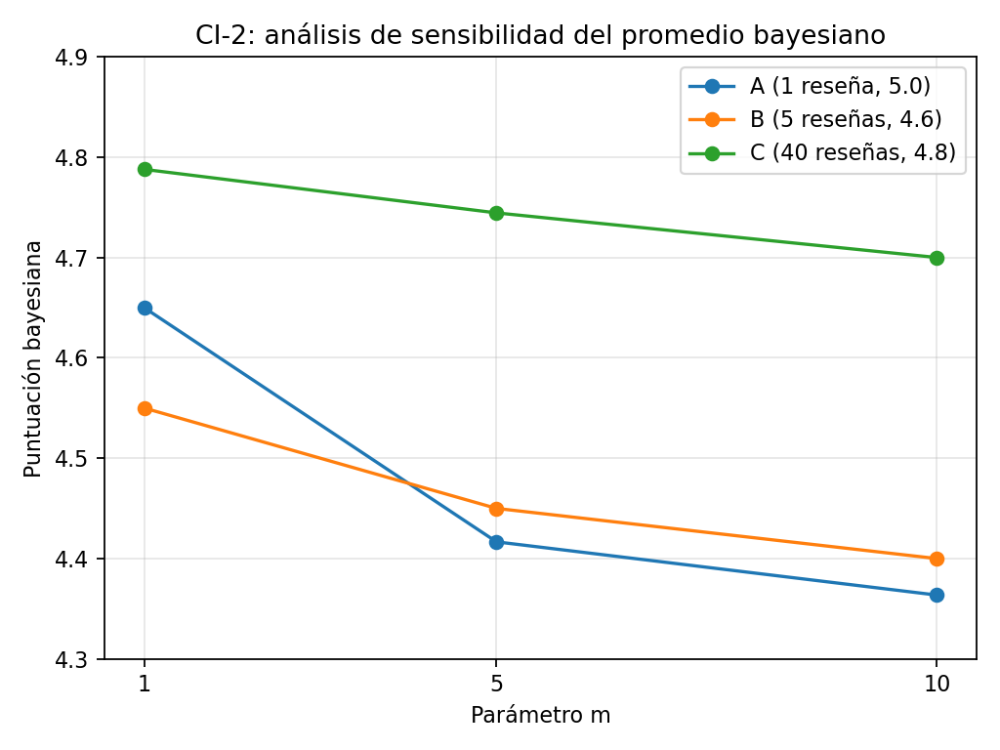

# CI-2 · Promedio bayesiano de estrellas

Responsable: Hugo. R3-C3 pide: formulación, supuestos, procedimiento, resultados y cómo influyó en el sistema.

## Formulación

B = (n·r + m·C) / (n + m)

n = reseñas válidas del maestro; r = su promedio bruto; C = promedio global de la plataforma; m = peso del promedio
global (E1 propone m = 5).

B es un promedio ponderado entre r y C: con pocas reseñas se acerca a C y con muchas converge a r. Evita que un maestro
con una sola reseña de 5 estrellas aparezca por sobre otro con 40 reseñas de 4,8.

## Supuestos

- Las reseñas válidas están ligadas a un contacto con servicio confirmado (RB-2, RB-7).
- Si no hay reseñas en la plataforma no existe C: se muestra «sin reseñas» y no se inventa un valor.
- B se usa solo para ordenar; no reemplaza la regla del Nivel 2 (≥ 5 reseñas y promedio bruto ≥ 4, RB-3).

## Procedimiento

1. Implementación en `src/lib/reputacion/promedioBayesiano.ts` con pruebas n = 0, 1, 5 y 50.
2. Escenario sintético con varios maestros (por ejemplo, 1 reseña de 5,0; 5 de 4,6; 40 de 4,8) y C = 4,3.
3. Sensibilidad: ordenar con m = 1, 5 y 10 y comparar el orden resultante.

## Resultados

Se realizó un análisis de sensibilidad con datos sintéticos para
comparar los valores m = 1, m = 5 y m = 10.

Se estableció C = 4,3 como promedio global de referencia.

| Maestro | n | r | B (m=1) | B (m=5) | B (m=10) |
|---|---:|---:|---:|---:|---:|
| A | 1 | 5,0 | 4,650 | 4,417 | 4,364 |
| B | 5 | 4,6 | 4,550 | 4,450 | 4,400 |
| C | 40 | 4,8 | 4,788 | 4,744 | 4,700 |

Los resultados se obtuvieron aplicando la fórmula
B = (n*r + m*C) / (n+m).

### Gráfico de sensibilidad

La siguiente figura compara la puntuación bayesiana de los tres
maestros al variar el parámetro m.

### Comparación de rankings

| Parámetro | Primer lugar | Segundo lugar | Tercer lugar |
|---|---|---|---|
| m = 1 | C | A | B |
| m = 5 | C | B | A |
| m = 10 | C | B | A |

Con m = 1, el maestro A supera al maestro B pese a contar
con una sola reseña. Al aumentar m a 5, el maestro B pasa
al segundo lugar, ya que sus cinco reseñas aportan mayor
evidencia que la única evaluación de A.

El maestro C mantiene el primer lugar en los tres escenarios
debido a su promedio alto y sus 40 reseñas.

### Interpretación de sensibilidad

- m = 1: el promedio individual adquiere influencia rápidamente.
  Una sola reseña puede elevar considerablemente la puntuación.
- m = 5: se reduce la influencia de reseñas aisladas. Con cinco
  reseñas, el promedio individual y el global tienen igual peso.
- m = 10: el promedio global conserva mayor influencia durante
  más tiempo, lo que puede perjudicar la diferenciación de
  maestros nuevos con buenas evaluaciones.

El análisis utiliza datos sintéticos y no constituye una
validación estadística con usuarios reales.

## Decisión e influencia en el sistema

Se adopta inicialmente m = 5, de acuerdo con la propuesta
de E1 y los resultados del análisis de sensibilidad.

Este valor permite equilibrar la reputación individual y
el promedio global, evitando que una única reseña determine
excesivamente la posición de un maestro.

La fórmula está implementada en TypeScript, en
`src/lib/reputacion/promedioBayesiano.ts`, y cuenta con
cinco pruebas unitarias en `promedioBayesiano.test.ts`.

La puntuación bayesiana está destinada al ordenamiento
de resultados. No reemplaza la regla RB-3 del Nivel 2,
que exige al menos cinco reseñas y un promedio bruto
de cuatro estrellas.

Si no existe un promedio global de la plataforma,
la función devuelve null y debe mostrarse
«sin reseñas», sin inventar una puntuación.

La integración efectiva del cálculo con el listado de
maestros y la presentación de la puntuación al usuario
deben verificarse por separado.
